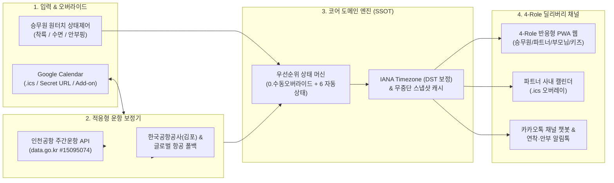

# ✈️ CrewPing (크루핑) — 승무원과 파트너·가족 모두를 위한 Google Calendar 양방향 컨시어지 (v3.6)

> **핵심 제품 철학: "설정은 30초 만에 간단하게, 사용은 터치 한 번으로 쉽게 — 그리고 누구에게도 연락이 부담되지 않게"**  
> 승무원이 평소 사용하는 **Google Calendar**(`.ics` 내보내기 · 비공개 피드 · 부가기능 Add-on)만 한 번 연결하면 나머지 시차·수속·수면 버퍼는 최적 기본값으로 자동 동작하며, **인천국제공항 공공 OpenAPI(#15095074)**와 결합해 **승무원 본인 · ❤️ 파트너(배우자·연인) · 🏡 부모님(어르신) · 🧒 아이들** 모두의 일상을 배려하는 4-Role 패밀리테크 플랫폼입니다.

---

## 1. 기획 배경 및 4대 포용적 페르소나 (SECTION 01)

단순히 가족이 승무원의 위치를 확인하는 일방적인 도구는 승무원에게 '응답 의무감'을 주어 오래 쓰이지 못합니다. **성별이나 혼인 여부와 무관하게** 모든 승무원과 파트너·가족이 함께 편해지는 양면(Two-Sided) 가치를 지향합니다.

| 역할 (Role) | 대상 페르소나 | 핵심 고충 및 니즈 |
| :--- | :--- | :--- |
| **🧑‍✈️ Crew View** | **국제/국내선 승무원 본인** (성별 무관) | • 착륙 직후 지친 상태에서 파트너·부모님께 각각 카톡 칠 필요 없는 **원터치 생존신고·방해금지 버튼** • 사내 게시판 **비행 맞교환(스왑)** 시 파트너·부모님 일정과 겹치는지 1초 만에 확인 • 카톡 100개 대신 **착륙 3줄 요약 브리핑**과 **쇼업(Show-up) 역산 알람** |
| **❤️ Partner View** | **파트너 (배우자 · 연인 / 이성친구)** | • 맞벌이 육아 시 공항 착륙 시각이 아닌 **'현관문 귀가 예측 시각(Door-to-Door)'** 파악 필요 • 미혼 연인의 경우 시차 방해 없이 배려하며 응원 메시지를 남길 타이밍 참고 • 승무원의 **스탠바이(대기 근무)** 돌발 호출 위험을 내 사내 아웃룩/구글 캘린더에 자동 마운트 |
| **🏡 Parents View** | **양가 부모님 · 어르신** (안부 & 돌봄 지원) | • 작은 캘린더 글씨 대신 **큰글씨(125% 확대) 단일 화면**으로 체류국 현지 시각과 수면 여부 확인 • 귀국편이 1시간 이상 연착되면 손주 하원 픽업 교대 시간을 미리 조정 |
| **🧒 Kids View** | **미취학 자녀** | • 숫자를 몰라도 비행기 이동 게이지와 남은 밤 수 카운터로 정서적 안정감 확보 • 헛된 통화 약속 대신 응원 카톡·사진을 남기고 편할 때 확인하도록 안내 |

---

## 2. 3대 핵심 UX 대원칙 (SECTION 02)

1. **초간단 2-Step 설정 ("설정은 간단하게 — 사용은 쉽게")**
   - 첫 설정 화면에는 **① Google Calendar 연결**(`.ics` 파일 1개 업로드 또는 비공개 URL 등록)과 **② 맞춤 안심 링크 복사** 딱 2가지만 노출해 30초 만에 온보딩을 끝냅니다.
   - 수동 개별 일정 추가, 수속/귀가 버퍼 미세조정, Google Calendar 부가기능 설정 등 복잡한 옵션은 **`⚙️ 세부 고급 설정 아코디언`** 안으로 접어두어(Progressive Disclosure) 화면 복잡도를 최소화합니다.
2. **무부담 소통 & 비확정적 예측 원칙 (Zero-Obligation & Soft-Estimation UX)**
   - 안내되는 모든 시간은 스케줄과 평균 소요시간 기반의 **단순 예측 참고치**일 뿐입니다.
   - 입국 심사 지연, 이동, 식사, 시차 피로 등 **당사자의 현지 여건과 컨디션에 따라 가이드된 시간에도 카톡 확인이나 음성·화상통화가 어려울 수 있음**을 웹과 카톡봇 전체에 상시 고지하며, 화상·음성통화를 당연시하는 표현을 전면 배제합니다.
3. **체류비(퍼디엠) 등 수치 정보의 '개략 가늠치' 및 산출 조건 명시**
   - 정확한 급여 정산으로 오해받지 않도록 10달러/만 원 단위의 **개략 가늠치(`약 $620 내외 / 약 86만 원대 추정`)**로 표기하고, 산출 가정 조건(단순 체류시간 × 권역별 임의 단가 × 참고 환율 1,390원/$) 및 실제 사내 정산액과의 차이 가능성을 명시합니다.

---

## 3. 승무원 본인을 위한 7대 전용 컨시어지 기능 (SECTION 03)

1. **⚡ 원터치 생존신고 & 내 컨디션 우선 오버라이드 3종**: `[🛬 무사 착륙! 이동 중]` · `[😴 지금부터 잘게(방해금지)]` · `[💬 지금 잠깐 여유 생겼어!(안부 핑)]` 터치 한 번으로 카톡 타이핑·통화 부담 없이 파트너·부모님 화면과 카톡봇 상태를 즉시 갱신
2. **🔄 동료와 '비행 맞교환(스왑)' 1초 충돌 체커**: 후보 비행 일시 입력 시 파트너 사내 캘린더(정기 배포·출장) 및 부모님 병원 일정 DB와 자동 대조해 돌봄 공백 유무 즉시 판정
3. **💌 착륙 직후 보는 '우리 집 3줄 요약 브리핑' (Landing Digest)**: 비행 중 파트너·부모님이 업데이트한 ① 아이들 컨디션·식사, ② 내일 등원 준비물, ③ 한줄 안부만 카드 한 장으로 확인
4. **🏡 거꾸로 보는 '한국 우리 집 일상 시계'**: 해외 호텔에서 한국 현재 시각 기준 집안 루틴(배우자 등원 준비 / 부모님 하원 픽업 / 심야 취침) 확인
5. **🚗 쇼업(Show-up) 역산 알람 & 공항 교통 브리핑**: 이륙(STD) - 브리핑 쇼업(2h20m) - 주차셔틀(25m) - 인천공항 실시간 도로 시간을 역산해 **집 현관문 출발 데드라인** 제시
6. **🌦️ 체류지 사복 날씨 & 심부름 공유 장바구니**: 서울 대비 현지 기온·우산·사복 차림 추천 및 면세점/현지 마트 체크박스 메모장
7. **📊 월간 시차 피로도 방패 & 체류비(퍼디엠) 개략 가늠치**: 장거리 누적 피로 시 가족 화면에 `🛡️ 무리한 외출 배려` 배지를 자동 표시하고 대략적인 외화 체류비 규모 가늠

---

## 4. Google Calendar 3단계 양방향 연동 [3-2] & 보안 아키텍처 [3-5] (SECTION 04~05)

### A. [3-2] Google Calendar 3-Way 연동 및 파트너 캘린더 마운트
- **Mode A (파일 업로드)**: Google Calendar `[설정 → 내보내기]`로 받은 표준 `.ics` 파일 업로드 즉시 `VEVENT` 파싱 (프로토타입 실제 구현 완료)
- **Mode B (자동 구독)**: 비공개 iCal 주소(`basic.ics`) 또는 `events.watch` 웹훅으로 스마트폰 캘린더 입력 즉시 자동 반영
- **Mode C (양방향 부가기능)**: Google Calendar 우측 사이드바 **Workspace Add-on**에서 등하원 담당 지정 및 공공API 연착 감지 시 캘린더 일정 종료 시각 자동 연장(`events.patch`) → 보강된 `.ics` 피드를 **❤️ 파트너의 사내 Outlook/Google 캘린더**에 자동 오버레이(`⚠️[스탠바이·야근주의]`)

### B. [3-5] Zero-Trust 동선 보호 & 4-Role 맞춤 화면 분리
- 공개 캘린더 전환으로 인한 부재중 주거 침입·스토킹 위험을 막기 위해 원본 캘린더는 비공개로 보호하고, **역할별 HMAC-SHA256 서명 초대 토큰 + 최초 접속 기기 쿠키 바인딩 + 원클릭 토큰 폐기(회전)**를 적용합니다.
- 단일 데이터(SSOT) 위에서 `🧑‍✈️ 승무원 뷰` / `❤️ 파트너 뷰` / `🏡 부모님 큰글씨 뷰` / `🧒 키즈 뷰` 4가지 맞춤 화면으로 렌더링됩니다.

---

## 5. 시스템 아키텍처 · 상태 머신 · 공공 API & 카톡봇 명세 (SECTION 06~08)

- **항공편 공공 API 구성**: 메인 **인천국제공항공사_여객편 주간 운항 현황(`#15095074`, D+0~D+6)** + 김포/국내선용 **한국공항공사 OpenAPI** + 해외 출발 지연 보완 폴백 어댑터. 비행 예정 `T-6시간~착륙` 구간에만 15~30분 주기로 깨어나는 **Adaptive Polling**으로 일일 무료 트래픽(500건)의 **3.5% 미만(일평균 12~18건)**만 소모합니다.
- **단계별 구축 로드맵**:
  - **Phase 1 (완료)**: 4-Role 인터랙티브 웹 프로토타입, `.ics` 실제 파서, 초간단 2-Step 설정, 승무원 전용 7대 라운지, 무부담 소통 UX 완성
  - **Phase 2 (2~3주)**: Cloudflare Workers + D1 서버리스 백엔드, Google Calendar API 양방향 연동, 공공API 실 인증키 가동
  - **Phase 3 (2주)**: 카카오 i 오픈빌더 챗봇 & 연착 알림톡 배포, 잠금화면 원터치/어르신 홈화면 PWA 출시

---

## 6. 산출물 파일 목록 (v3.6 동기화 완료)
- [index.html](file:///Users/lotte/IdeaProjects/etc/minigame/crew-connect/index.html) / [style.css](file:///Users/lotte/IdeaProjects/etc/minigame/crew-connect/style.css) / [app.js](file:///Users/lotte/IdeaProjects/etc/minigame/crew-connect/app.js) — 인터랙티브 웹 프로토타입 (v3.6)
- [proposal.html](file:///Users/lotte/IdeaProjects/etc/minigame/crew-connect/proposal.html) — 인쇄 전용 9페이지 제안서 원본 (v3.6)
- [CrewPing_포트폴리오_제안서.pdf](file:///Users/lotte/IdeaProjects/etc/minigame/crew-connect/CrewPing_포트폴리오_제안서.pdf) — A4 9페이지 포트폴리오·기술 제안서 PDF (v3.6)
